# Trafika

Plan an Instagram post and a printed, numbered zine side by side, from the same photos.

**[Open the web app](https://microneclious.github.io/Trafika/)** · **[Download for Linux (AppImage)](https://github.com/microneclious/Trafika/releases/latest)**

[](https://github.com/microneclious/Trafika/actions/workflows/pages.yml)
[](https://github.com/microneclious/Trafika/actions/workflows/release.yml)
[](LICENSE)

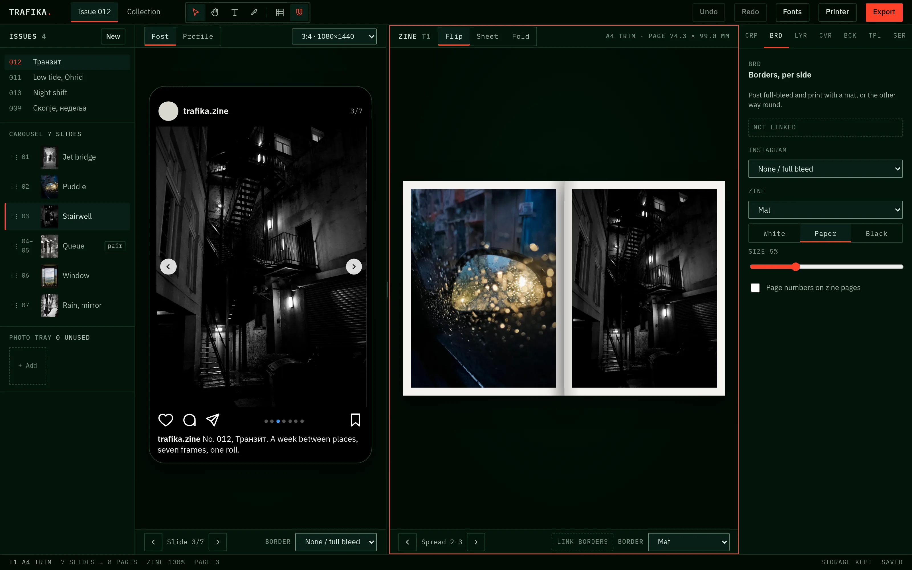

<p align="center">
  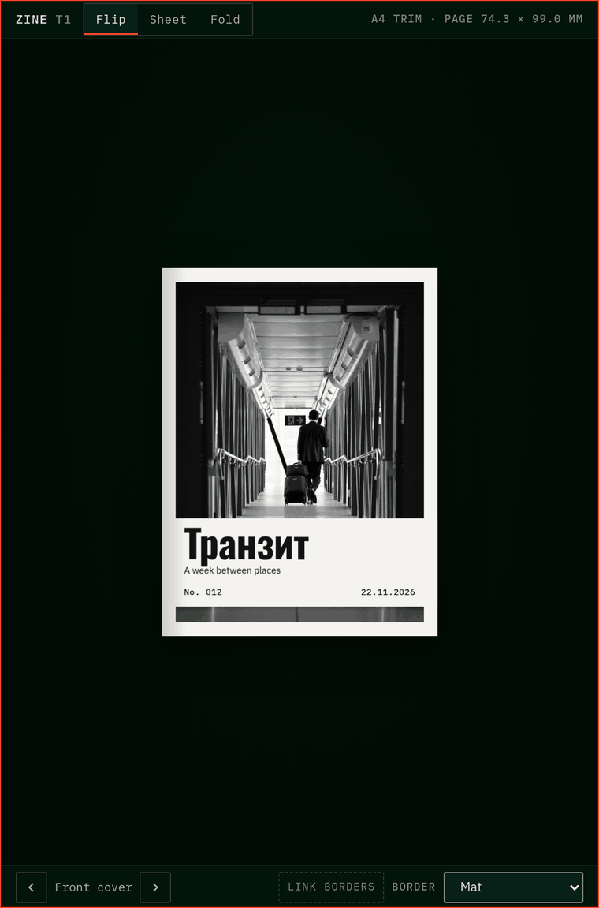
  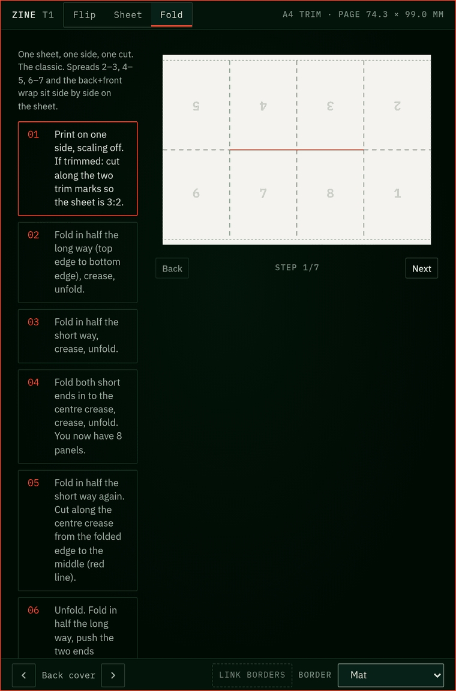
</p>

## Why

I post photos on Instagram and I print them as small zines, and the two never fit the same way: different aspect ratios, different crops, different layouts. Trafika plans both from the same photos, so every post becomes a numbered physical zine.

## What it does

| | |
|---|---|
| 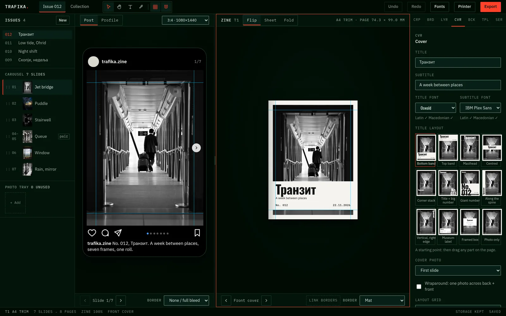 | **Split view and per-side borders.** The post and the zine sit side by side. Borders, crops and layouts can match or differ: post full-bleed and print with a mat, or the other way round.<br><br>**Covers.** Twelve title layouts, any font (Latin and Cyrillic), layout grids with snapping, an optional wraparound photo across the back and front. |
| 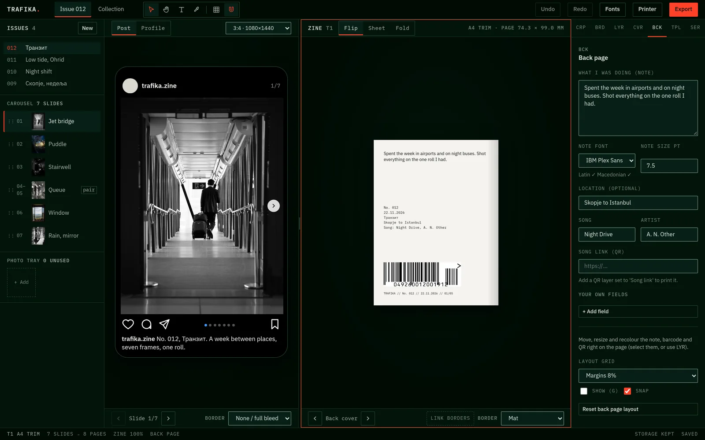 | **Back page.** A note, place and song, your own fields, a QR code that opens whatever you put in it, all draggable and recolourable. |
| 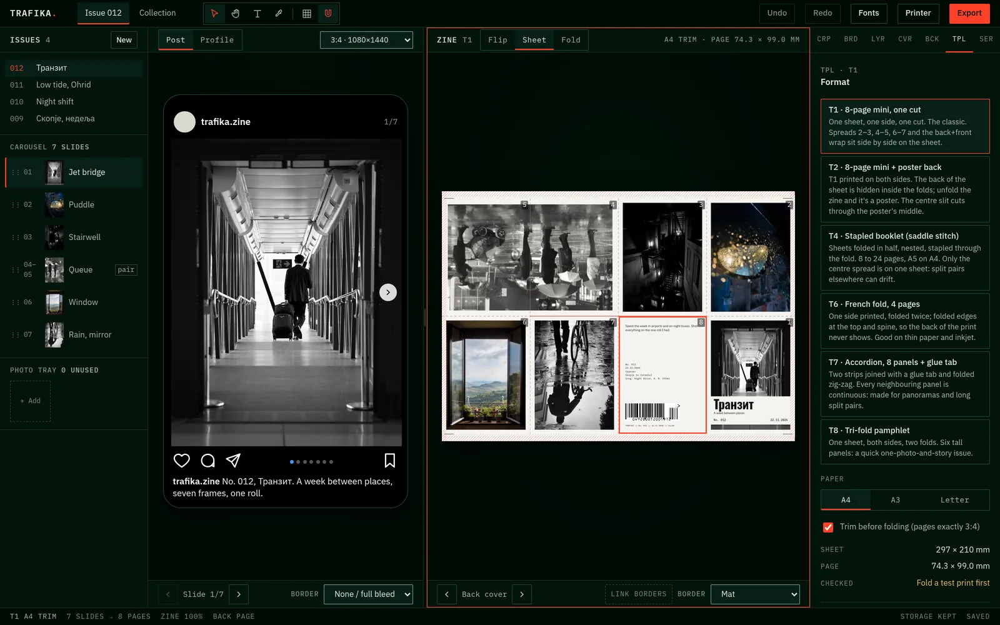 | **Flip, sheet and fold views.** Flip through the booklet as it will read, see the exact print sheet with cut and fold lines, then follow numbered folding steps. |
| 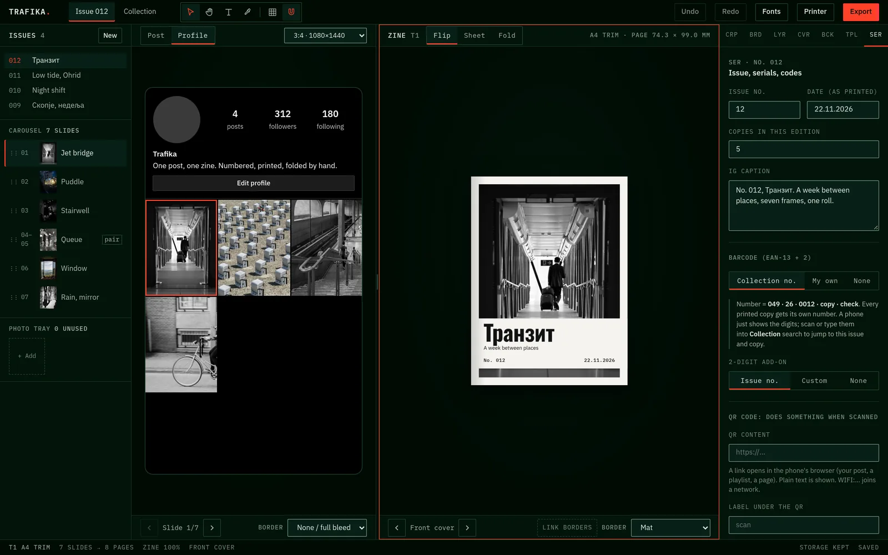 | **Profile grid.** Every issue as a post in a mock profile, cropped the way Instagram's grid crops it. |
| 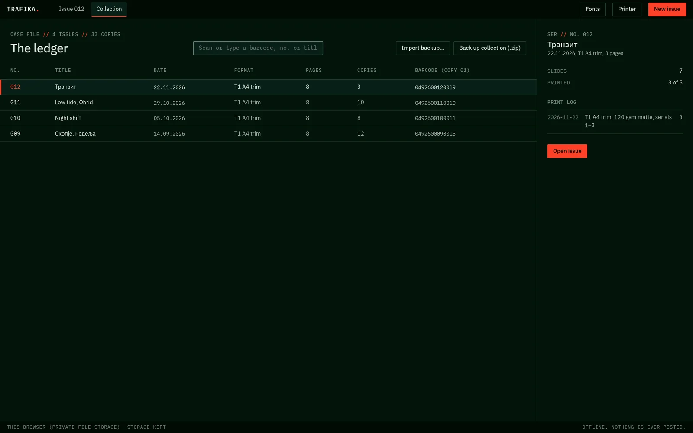 | **Serials and barcodes.** Every printed copy gets its own serial (`03/05`) and EAN-13 + 2 barcode. Scan one into the ledger search to jump to its issue and copy. |

**Exports:** Instagram slides as sRGB JPEGs with no camera or GPS data, plus the caption; print PDFs at 300 DPI with optional guides; a numbered test print to check your folding.

## The 3:4 trim trick

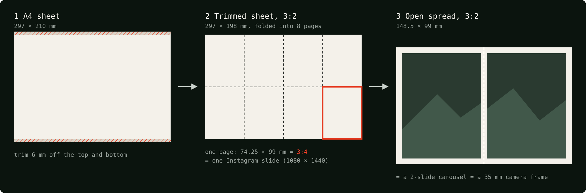

Trim 6 mm off the top and bottom of an A4 sheet and every page of the classic 8-page mini zine comes out exactly 3:4, the shape of a portrait Instagram slide. Two pages side by side make a 3:2 spread: a two-slide carousel, and the shape of a 35 mm camera frame. So the same photo fits the post, the page and the camera without a second crop.

## Templates

| Template | Pages | Paper | How it's made |
|---|---|---|---|
| **T1** 8-page mini, one cut<br> | 8 | A4, A3, Letter; one side | One sheet, one cut, folded. The classic. |
| **T2** 8-page mini + poster<br>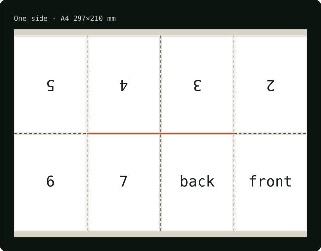 | 8 + poster | A4, A3, Letter; both sides (short edge) | T1 with a full-sheet poster on the back, hidden in the folds. |
| **T4** Stapled booklet<br>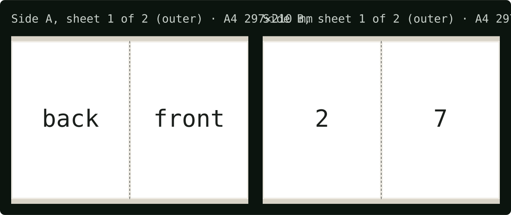 | 8–24 | A4 (A5 pages), A3, Letter; both sides | Sheets folded, nested and stapled through the fold. |
| **T6** French fold<br>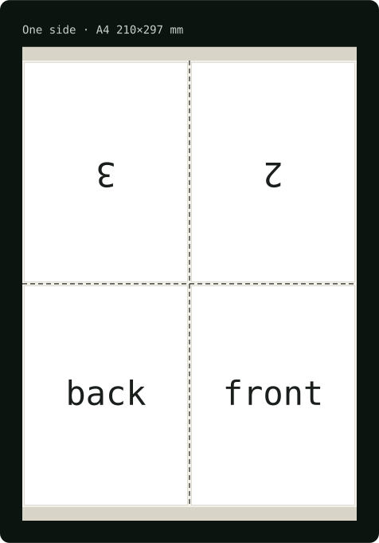 | 4 | A4, A3, Letter; one side | Folded twice so the back of the print never shows. Good on thin paper and inkjet. |
| **T7** Accordion + glue tab<br>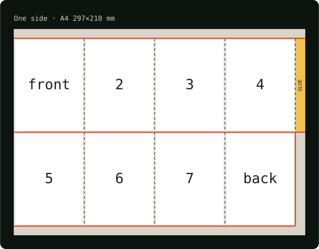 | 8 | A4, A3, Letter; one side | Two strips glued into one zig-zag. Made for panoramas. |
| **T8** Tri-fold pamphlet<br>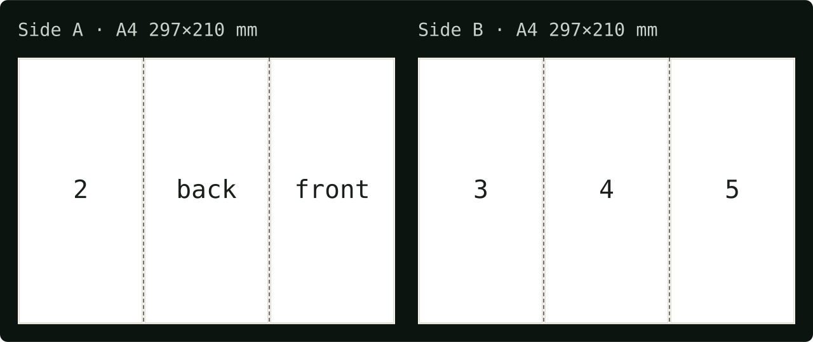 | 6 | A4, Letter; both sides (short edge) | Two folds, six tall panels. |

Red lines are cuts, dashed lines are folds, the grey strips are trimmed off. Numbers upside down are printed upside down on purpose: they come out the right way up once folded. 100–120 gsm paper folds cleanly; for double-sided templates, print a numbered test first and calibrate your printer (Printer, in the app).

## Privacy

- **Offline.** The web app is cached on your device after the first visit and makes no network requests after that: no analytics, no fonts or scripts from other sites. A strict Content-Security-Policy enforces it, and the build fails if any external host shows up in the code.
- **No uploads.** Photos stay on your computer: in `~/Zines` in the Linux app, in the browser's private storage in the web app.
- **Nothing is posted for you.** No Instagram or Meta connection, no accounts. You export the slides and post them yourself.
- **Back up.** Browsers can clear their storage, so the web app reminds you to export a `.zip` backup. The same `.zip` opens in the Linux app and the web app.

## Get it

- **Web:** just open **[microneclious.github.io/Trafika](https://microneclious.github.io/Trafika/)**. Works in any modern browser, nothing to install, and it keeps working offline.
- **Linux:** download `Trafika_*.AppImage` from **[Releases](https://github.com/microneclious/Trafika/releases/latest)**, then:

  ```sh
  chmod +x Trafika_*.AppImage && ./Trafika_*.AppImage
  ```

  One file, runs on Fedora, Manjaro/Arch, Ubuntu, Debian and most other distros.
  Won't start? Install FUSE 2 (`sudo dnf install fuse-libs` / `sudo pacman -S fuse2` / `sudo apt install libfuse2`).
  Blank window? Run it with `WEBKIT_DISABLE_DMABUF_RENDERER=1`.

## Run it from source

```sh
npm ci
npm run dev                                  # web app at http://localhost:1420
npm run tauri build -- --bundles appimage    # Linux app (needs Rust + WebKitGTK 4.1 dev libs)
```

### Project structure

```
src/
  engine/      layout in mm, imposition templates (JSON), barcodes, grids: no UI, fully tested
  render/      one Canvas2D renderer for screen, JPEG and PDF; fonts; image cache
  export/      Instagram JPEGs, print PDFs, calibration page
  platform/    the only code that touches files: tauri.ts (Linux app), web.ts (browser),
               backup.ts (.zip format shared by both)
  store/       app state, undo/redo, autosave
  ui/          React components
src-tauri/     the Linux app shell (Rust): ~/Zines files, fonts via fontconfig, printing via lp
docs/          spec, user guide, demo photos and README images
scripts/       offline check, icon, desktop launcher
```

## Documentation

- [User guide](docs/USER_GUIDE.md): your first issue, printer calibration, trimming and folding
- [Changelog](CHANGELOG.md)
- [Spec](docs/ZINE_SPEC.md)

## Credits

- Inspired by the one-sheet zine tradition, and by [dirtylittlezine.com](https://dirtylittlezine.com) among many others.
- Fonts: [IBM Plex Sans and IBM Plex Mono](https://github.com/IBM/plex) and [Oswald](https://github.com/googlefonts/OswaldFont), under the SIL Open Font License 1.1 (licence texts in [`public/licenses/`](public/licenses)).
- Built with Tauri, React, pdf-lib, bwip-js and zustand.
- The demo photos in the screenshots come from Wikimedia Commons, under CC BY / CC BY-SA / CC0. The photographers and licences are in [`docs/demo-photos/CREDITS.md`](docs/demo-photos/CREDITS.md). The screenshots that show those photos share their licences.

## Licence

Code: [MIT](LICENSE). Bundled fonts keep their OFL licence. Demo photos keep their own licences.
